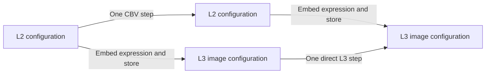
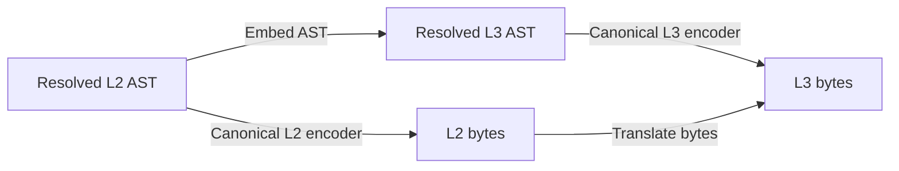

# Cambridge L2 into L3

The L1/L2 operational adapters use each course's existing CBV relation and
share the same named integer store. In L2, assignment and dereference
still carry a location name directly. L3 instead takes a reference
expression in these positions and stores arbitrary values. The L2→L3
embedding sends a named cell to an explicit numeric `loc` expression and
stores the corresponding L3 integer value.
[L1/L2 operational adapters](../projects/operational-institutions.md#cambridge-l1-and-l2) ·
[L2 syntax](../../Silmaril/Courses/Cambridge/L2/Syntax.lean) ·
[L3 syntax](../../Silmaril/Courses/Cambridge/L3/Syntax.lean)

## Expression, store and reduction

The translation covers the complete resolved L2 CBV grammar. It preserves
free names, de Bruijn indices, arrows, lambda, application, strict let, both
let-rec binders, and the imperative constructs. A single injective layout
maps cell names to natural-number addresses in expressions, store domains
and location typing environments. `unicodeLayout` is a concrete choice
that encodes the list of Unicode scalar values. Other injective layouts
work in every theorem. Expression and store embeddings are injective.
[Definitions](../../Silmaril/Courses/Cambridge/L2ToL3/Defs.lean)



| Theorem | Scope |
| --- | --- |
| `typing` | L2 expression typing maps to L3 typing at the translated type and environments. |
| `store_typed` | L3 store typing follows when the L2 store and location environment have identical domains. |
| `step` and `steps` | Forward preservation on all source configurations. The one-step theorem includes beta substitution, recursive closure unfolding and writes to allocated integer cells. |
| `reflect_step` and `reflect_steps` | With L2 expression typing, every direct L3 successor and every finite reachable configuration is the image of a corresponding L2 run. This includes stores with holes. |
| `may_return_iff`, `stuck_iff` and `infinite_iff` | At a typed source, finite may returns with complete final stores, stuckness and infinite traces agree. |

Typing matters for reflection. The checked untyped Boolean write is stuck
in L2 and has a write step in L3. The image supplies no allocation constructs
or fresh-name choices. The checked let-rec example passes an integer
argument, updates the cell named `λ`, and returns the written integer with
the whole translated store.
[Operational theorems](../../Silmaril/Courses/Cambridge/L2ToL3/Thms.lean) ·
[Checked examples](../../Silmaril/Courses/Cambridge/L2ToL3/Examples.lean)

## Canonical resolved-term bytes



The square commutes for canonical UTF-8 S-expression and JSON bytes.
The byte translators validate input with the public L2 resolved-term
decoders and rewrite the canonical constructor tree. The executable
tree rewrite is proved to equal the encoding of the embedded AST. It
changes the envelope language from `L2` to `L3` and replaces the atom
in a location field with a `loc` node holding the decimal address.
A free variable with the same spelling is still a string atom inside
`fvar`. The sort remains `resolved-term`, with de Bruijn indices for
bound occurrences. Named surface syntax has its own codec.

The translators use the public byte codecs. Alternate accepted spellings
are normalized by decoding and canonical reprinting. Injectivity is
checked on canonical L2 encodings for each fixed layout and format.
[Byte embedding theorems](../../Silmaril/Courses/Cambridge/L2ToL3/Bytes.lean) ·
[Resolved AST formats](cambridge-ast-codecs.md)

```sh
lake build --wfail +Silmaril.Courses.Cambridge.L2ToL3
```
